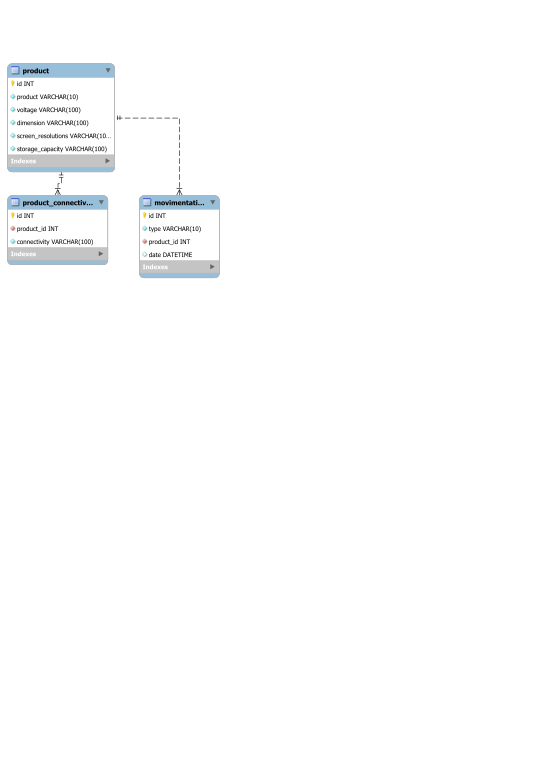

# Stock Manager API

Inventory management API for electronic products, with entry and exit control, minimum-stock alerts and a complete movement history. Developed as part of the **SAEP** practical assessment.

> Frontend: [stock-manager-web](https://github.com/Joao-Adegas/stock-manager-web)

## Problem

A local electronics retailer struggles with stock management because there is no computerized system. This API addresses:

- Lack of control over stock entries and exits
- Minimum stock with automatic alert
- Complete historical record
- Organization of products with many different characteristics
- Shortages and excess of items in stock

## Features

- User authentication
- Create, list, edit and delete products
- Search products by name
- Stock management (entry and exit)
- Automatic alert when stock reaches the minimum level
- Movement history

## Data model



**User:** id, username, password, email, first_name, last_name, last_login, is_superuser, is_staff, is_active, date_joined

**Product:** id, product (smartphone, notebook, smartTV), name, voltage, dimension, screen_resolutions, storage_capacity, connectivity (JSON), stock, min_stock

**Movimentation:** id, type (input/output), product_id, quantity, date

```sql
CREATE TABLE product (
    id INT AUTO_INCREMENT PRIMARY KEY,
    product ENUM('smartphone','notebook','smartTV') NOT NULL,
    name VARCHAR(100) NOT NULL,
    voltage VARCHAR(100) NOT NULL,
    dimension VARCHAR(100) NOT NULL,
    screen_resolutions VARCHAR(100) NOT NULL,
    storage_capacity VARCHAR(100) NOT NULL,
    connectivity JSON NOT NULL,
    stock INT UNSIGNED NOT NULL,
    min_stock INT UNSIGNED NOT NULL
);
```

## Tech stack

MySQL

<!-- CONFIRM: backend framework (the User table follows Django's default fields) -->

## Getting started

<!-- CONFIRM: prerequisites, environment setup and run commands -->

## Author

João Pedro dos Santos Adegas — [@Joao-Adegas](https://github.com/Joao-Adegas)
